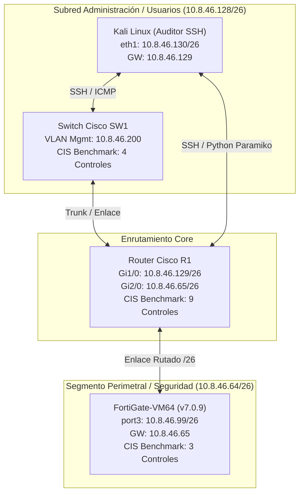
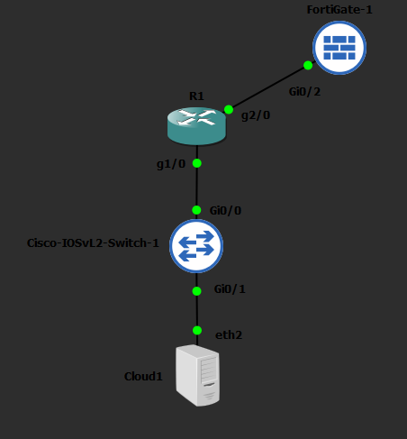
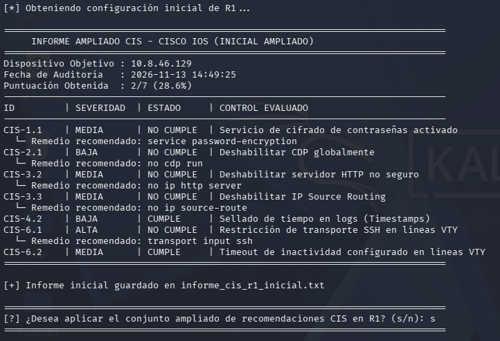
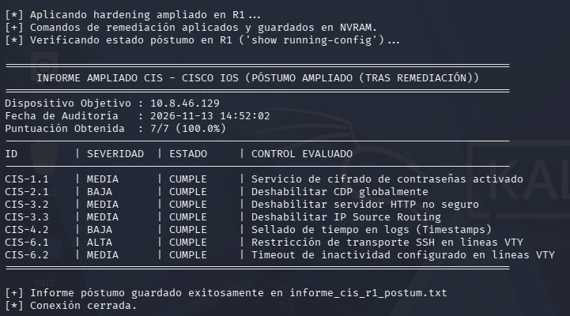
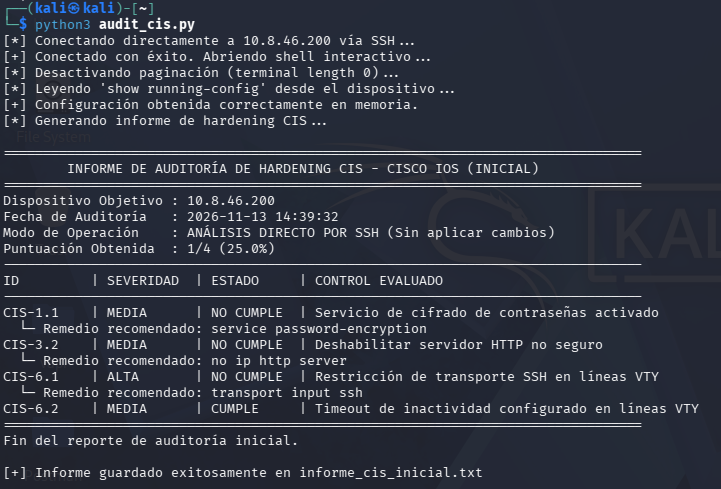
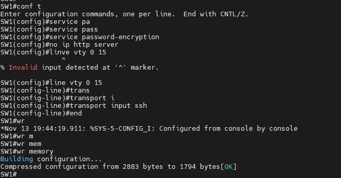
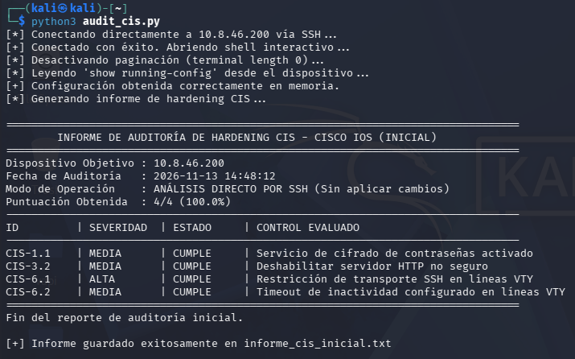
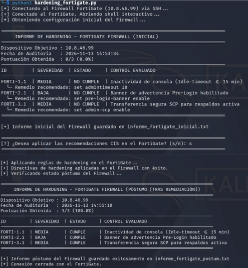
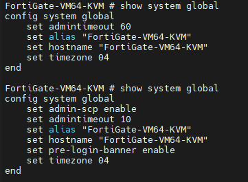

# Auditoría y Hardening Automatizado Basado en CIS Benchmark (Cisco IOS & FortiOS)

---

## 🎥 Video Demostrativo

**Enlace a YouTube:** [Ver Demostración en YouTube](https://www.youtube.com/watch?v=ohSgcJKaOtA)

---

## 1. Propósito del Laboratorio

El objetivo de este laboratorio es diseñar, implementar y validar un entorno de red empresarial segmentado en **GNS3** compuesto por infraestructura heterogénea (**Router Cisco R1**, **Switch Cisco SW1** y **Firewall FortiGate**), aplicando controles de seguridad basados en los estándares del **CIS Benchmark (Center for Internet Security)**.

Para lograr una gestión eficiente, repetible y libre de errores humanos, se desarrolló una suite de **herramientas de auditoría y remediación automatizada en Python (librería `Paramiko` sobre SSH)** desde una estación de administración **Kali Linux**. El sistema permite evaluar el estado de seguridad inicial de cada dispositivo sin alterar su configuración, generar un reporte de cumplimiento y, previa confirmación del administrador, aplicar las directivas de endurecimiento (*hardening*) para emitir un informe posterior que verifica el **100% de cumplimiento**.

---

## 2. Topología y Diagramas de Arquitectura

### 2.1 Diagrama Lógico de Red



### 2.2 Captura de la Topología en GNS3



---

## 3. Esquema de Direccionamiento IP

Todo el direccionamiento privado del laboratorio se calculó a partir de los últimos cuatro dígitos de la matrícula **`2025-0846`** (`0846` → segundo y tercer octeto **`8.46`**), estructurado bajo el bloque **`10.8.46.0/24`** y subdividido mediante **VLSM (/26)**:

| Dispositivo | Interfaz / VLAN | Dirección IP | Máscara de Subred | Gateway | Rol en la Topología |
| --- | --- | --- | --- | --- | --- |
| **Router R1** | `GigabitEthernet1/0` | `10.8.46.129` | `255.255.255.192` (`/26`) | N/A | Gateway subred LAN / Administración |
| **Router R1** | `GigabitEthernet2/0` | `10.8.46.65` | `255.255.255.192` (`/26`) | N/A | Gateway subred Firewall Perimetral |
| **Kali Linux** | `eth1` | `10.8.46.130` | `255.255.255.192` (`/26`) | `10.8.46.129` | Estación de Auditoría y Ejecución Python |
| **Switch SW1** | `SVI / Gestión` | `10.8.46.200` | `255.255.255.192` (`/26`) | `10.8.46.129` | Conmutación Capa 2 y Seguridad VTY |
| **FortiGate FW** | `port3` | `10.8.46.99` | `255.255.255.192` (`/26`) | `10.8.46.65` | Firewall Perimetral (FortiOS v7.0.9) |

---

## 4. Herramientas de Análisis CIS y Scripts Automatizados

Se desarrollaron tres scripts en **Python 3** ubicados en la carpeta [`scripts/`](scripts/), que usan **`Paramiko`** para sesiones SSH interactivas y expresiones regulares (`re`) para auditar cada control:

1. **[`scripts/hardening_r1.py`](scripts/hardening_r1.py):** Audita 9 controles CIS en el Router Cisco `R1`, genera [`reportes/informe_r1_inicial.txt`](reportes/informe_r1_inicial.txt) sin modificar el equipo y pregunta `(s/n)` si se desea remediar. Al confirmar, inyecta los comandos, guarda en NVRAM (`write memory`) y genera [`reportes/informe_r1_postum.txt`](reportes/informe_r1_postum.txt).
2. **[`scripts/auditoria_sw1.py`](scripts/auditoria_sw1.py):** Realiza una auditoría directa de solo lectura contra el Switch Cisco `SW1` (`10.8.46.200`) evaluando 4 controles críticos de acceso y cifrado, y genera informes antes y después de la remediación manual en CLI.
3. **[`scripts/hardening_fortigate.py`](scripts/hardening_fortigate.py):** Se conecta por SSH al Firewall FortiGate (`10.8.46.99`), evalúa `show system global` contra 3 controles CIS de FortiOS, guarda [`reportes/informe_fortigate_inicial.txt`](reportes/informe_fortigate_inicial.txt) y, tras la confirmación `(s/n)`, aplica las directivas globales y genera [`reportes/informe_fortigate_postum.txt`](reportes/informe_fortigate_postum.txt).

---

## 5. Recomendaciones CIS Benchmark Aplicadas y Justificación Técnica

### 5.1 Router Cisco (`R1` - `10.8.46.129`)

| ID Control | Comando Aplicado | Severidad | ¿Por qué se aplicó? |
| --- | --- | --- | --- |
| **CIS-1.1** | `service password-encryption` | Media | Evita que las contraseñas locales y de líneas VTY/Consola se almacenen en texto claro en el `running-config`, mitigando su exposición si se compromete un respaldo. |
| **CIS-2.1** | `service tcp-keepalives-in` | Baja | Detecta y cierra sesiones TCP entrantes huérfanas o colgadas, liberando memoria y evitando el agotamiento de líneas VTY por ataques DoS. |
| **CIS-2.2** | `service tcp-keepalives-out` | Baja | Garantiza el cierre automático de conexiones salientes inactivas hacia servidores o gestores remotos. |
| **CIS-3.1** | `no ip source-route` | Alta | Bloquea paquetes IP que especifican su propia ruta en la cabecera, previniendo ataques de *IP Spoofing* y evasión de controles perimetrales. |
| **CIS-3.2** | `no ip http server` | Media | Deshabilita la interfaz web administrativa sin cifrar (TCP 80), evitando el robo de credenciales en texto plano mediante sniffing. |
| **CIS-4.1** | `ip ssh time-out 60` | Media | Limita a 60 segundos el tiempo para completar la negociación de autenticación SSH, reduciendo la ventana de exposición de conexiones abiertas. |
| **CIS-4.2** | `ip ssh authentication-retries 3` | Media | Restringe a 3 los intentos fallidos de inicio de sesión por conexión SSH, mitigando ataques de fuerza bruta automatizados. |
| **CIS-6.1** | `transport input ssh` | Alta | Deshabilita el protocolo inseguro **Telnet** en las líneas `vty 0 4`, obligando a que toda administración remota viaje cifrada mediante **SSH**. |
| **CIS-6.2** | `exec-timeout 10 0` | Media | Cierra automáticamente las sesiones administrativas inactivas tras 10 minutos, previniendo accesos no autorizados desde terminales desatendidas. |

*Adicionalmente se deshabilitaron servicios innecesarios de descubrimiento y arranque con `no cdp run` y `no ip bootp server` para reducir la superficie de ataque.*

---

### 5.2 Switch Cisco (`SW1` - `10.8.46.200`)

| ID Control | Comando Aplicado | Severidad | ¿Por qué se aplicó? |
| --- | --- | --- | --- |
| **CIS-1.1** | `service password-encryption` | Media | Cifra mediante algoritmo Tipo 7 las contraseñas almacenadas en la configuración del conmutador para impedir su lectura directa. |
| **CIS-3.2** | `no ip http server` | Media | Cierra el servidor HTTP en texto plano del switch, eliminando vectores de captura de credenciales administrativas en la LAN. |
| **CIS-6.1** | `transport input ssh` | Alta | Configurado en todas las líneas `vty 0 15` para bloquear conexiones Telnet y exigir cifrado SSH en la gestión remota. |
| **CIS-6.2** | `exec-timeout 10 0` | Media | Establece un tiempo máximo de inactividad de 10 minutos en `line vty 0 15`, cerrando sesiones olvidadas por el administrador. |

---

### 5.3 Firewall FortiGate (`FortiGate-VM64` - `10.8.46.99`)

| ID Control | Comando Aplicado (`config system global`) | Severidad | ¿Por qué se aplicó? |
| --- | --- | --- | --- |
| **FORTI-1.1** | `set admintimeout 10` | Media | Reduce el tiempo de inactividad de la sesión administrativa (GUI y CLI) de 60 a 10 minutos, evitando el secuestro de sesión. |
| **FORTI-2.1** | `set pre-login-banner enable` | Baja | Muestra un aviso legal antes de la autenticación, disuadiendo accesos no autorizados y respaldando acciones legales ante intrusiones. |
| **FORTI-3.1** | `set admin-scp enable` | Media | Habilita el protocolo **SCP** sobre SSH para la extracción segura de respaldos de configuración, evitando transferencias en claro. |

---

## 6. Pruebas y Evidencias de Verificación (Antes vs. Después)

### 6.1 Router Cisco `R1`: De 0.0% a 100.0% de Cumplimiento

1. **Auditoría Inicial (vulnerable):** El script detecta que los 9 controles CIS fallan (`0/9 - 0.0%`) y solicita confirmación interactiva.

   

2. **Remediación Automatizada y Verificación CLI:** Al ingresar `s`, el script aplica los 9 controles, guarda la configuración y confirma **`9/9 (100.0%)`**.

   

---

### 6.2 Switch Cisco `SW1`: Auditoría por Script y Remediación Verificada

1. **Escaneo Inicial:** `auditoria_sw1.py` evalúa el switch sin realizar cambios, detectando brechas en cifrado, HTTP y líneas VTY (`1/4 - 25.0%`).

   

2. **Aplicación de Controles en CLI:** Se aplican las directivas CIS en `line vty 0 15` y en modo global.

   

3. **Verificación Posterior:** Una nueva ejecución del auditor confirma el cumplimiento total (**`4/4 - 100.0%`**).

   

---

### 6.3 Firewall FortiGate: De 0.0% a 100.0% en FortiOS v7.0.9

1. **Ejecución de `hardening_fortigate.py`:** Muestra el informe inicial en **`0/3 (0.0%)`**, solicita confirmación `(s/n)` y aplica las directivas globales hasta alcanzar **`3/3 (100.0%)`**.

   

2. **Validación en Consola FortiOS:** Ejecución de `show system global` que confirma la persistencia de `admintimeout 10`, `pre-login-banner enable` y `admin-scp enable`.

   

---

### 6.4 Reportes Generados y Configuraciones (`Running-Configs`)

**Configuraciones Activas (`configs/`):**
* [`configs/R1_running-config.txt`](configs/R1_running-config.txt)
* [`configs/SW1_running-config.txt`](configs/SW1_running-config.txt)
* [`configs/FortiGate_running-config.txt`](configs/FortiGate_running-config.txt)

**Reportes de Auditoría (`reportes/`):**
* [`informe_r1_inicial.txt`](reportes/informe_r1_inicial.txt) | [`informe_r1_postum.txt`](reportes/informe_r1_postum.txt)
* [`informe_sw1_inicial.txt`](reportes/informe_sw1_inicial.txt) | [`informe_sw1_postum.txt`](reportes/informe_sw1_postum.txt)
* [`informe_fortigate_inicial.txt`](reportes/informe_fortigate_inicial.txt) | [`informe_fortigate_postum.txt`](reportes/informe_fortigate_postum.txt)

---

## 7. Estructura del Repositorio

```text
├── README.md                              # Documentación técnica del proyecto
├── scripts/
│   ├── hardening_r1.py                    # Auditoría y hardening automatizado Router R1
│   ├── auditoria_sw1.py                   # Auditoría CIS directa Switch SW1
│   └── hardening_fortigate.py             # Auditoría y hardening automatizado FortiGate
├── configs/
│   ├── R1_running-config.txt              # Running-config endurecido del Router R1
│   ├── SW1_running-config.txt             # Running-config endurecido del Switch SW1
│   └── FortiGate_running-config.txt       # Configuración endurecida del Firewall FortiGate
├── reportes/
│   ├── informe_r1_inicial.txt             # Reporte inicial R1 (0%)
│   ├── informe_r1_postum.txt              # Reporte posterior R1 (100%)
│   ├── informe_sw1_inicial.txt            # Reporte inicial SW1
│   ├── informe_sw1_postum.txt             # Reporte posterior SW1 (100%)
│   ├── informe_fortigate_inicial.txt      # Reporte inicial FortiGate (0%)
│   └── informe_fortigate_postum.txt       # Reporte posterior FortiGate (100%)
└── img/
    ├── 01_topologia_gns3.png
    ├── 02_conectividad_ssh_kali.png
    ├── 03_r1_auditoria_inicial.png
    ├── 04_r1_remediacion_postuma.png
    ├── 05_sw1_auditoria_inicial.png
    ├── 06_sw1_hardening_manual_cli.png
    ├── 07_sw1_verificacion_postuma.png
    ├── 08_fortigate_auditoria_y_hardening.png
    ├── 09_fortigate_verificacion_cli.png
    └── 10_reportes_generados_txt.png
```
